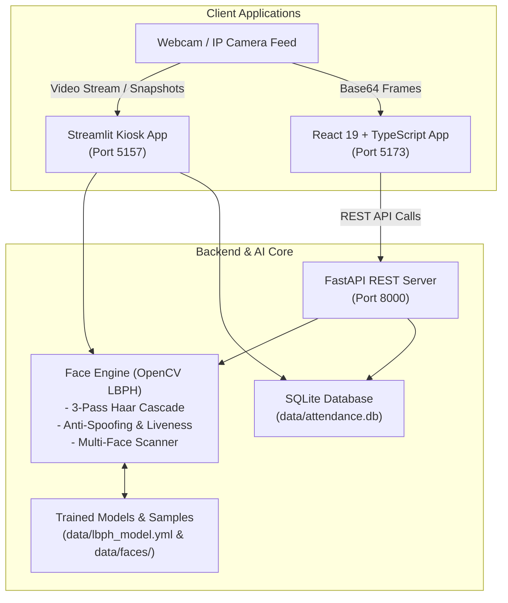

# FastTrackAttendance 🎓⚡
### AI-Powered Multi-Face Attendance, Anti-Spoofing & Real-Time Analytics System

[](https://www.python.org/)
[](https://opencv.org/)
[](https://streamlit.io/)
[](https://fastapi.tiangolo.com/)
[](https://react.dev/)
[](https://www.typescriptlang.org/)
[](https://vitejs.dev/)
[](https://www.sqlite.org/)

**FastTrackAttendance** (SmartAttend AI) is an enterprise-grade automated attendance solution combining biometric face recognition, multi-factor anti-spoofing liveness verification, multi-student classroom scanning, and predictive analytics. 

It provides both a lightweight **Streamlit UI** for rapid desktop/kiosk deployments and a high-performance **FastAPI REST backend** paired with a modern **React 19 + TypeScript web application** with Role-Based Access Control (Admin, Faculty, Student).

---

## 📑 Table of Contents

- [Key Features](#-key-features)
- [System Architecture](#-system-architecture)
- [Project Structure](#-project-structure)
- [Prerequisites](#-prerequisites)
- [Installation & Setup](#-installation--setup)
  - [1. Clone Repository](#1-clone-repository)
  - [2. Python Backend & Streamlit Setup](#2-python-backend--streamlit-setup)
  - [3. React Web Frontend Setup](#3-react-web-frontend-setup)
- [Running the Applications](#-running-the-applications)
  - [Option A: Streamlit All-in-One Dashboard](#option-a-streamlit-all-in-one-dashboard)
  - [Option B: FastAPI REST Service + React Frontend](#option-b-fastapi-rest-service--react-frontend)
- [Demo Credentials](#-demo-credentials-react-app)
- [REST API Reference](#-rest-api-reference)
- [Face Recognition & Anti-Spoofing Engine](#-face-recognition--anti-spoofing-engine)
- [Database Schema](#-database-schema)
- [Configuration & Tuning](#-configuration--tuning)
- [Troubleshooting & FAQs](#-troubleshooting--faqs)
- [License](#-license)

---

## 🌟 Key Features

### 👁️ Biometric Face Recognition
- **LBPH (Local Binary Patterns Histograms)**: Robust against lighting variations and fast enough for edge/desktop execution without heavy GPU requirements.
- **3-Pass Cascade Detection**: Employs adaptive multi-stage Haar cascades (strict $\rightarrow$ moderate $\rightarrow$ lenient) to capture near, angled, and distant faces.
- **Multi-Face Classroom Mode**: Recognizes and logs multiple students in a single wide-angle camera frame simultaneously.

### 🛡️ Multi-Factor Anti-Spoofing & Liveness Detection
Prevents proxy attendance, photo presentations, LCD replays, and printed cutouts via a 3-layer verification pipeline:
1. **Laplacian Texture Gradient**: Analyzes micro-texture variance ($Var \ge 65$) to detect flat paper surfaces and blurred prints.
2. **Bilateral Eye Landmark Validation**: Ensures authentic biological facial structures through dual eye-cascade tracking.
3. **YCrCb Chrominance Gamut Filtering**: Validates biological human skin reflectance ratios against artificial backlit LCD/OLED screens.

### 📊 Attendance Analytics & Defaulter Automation
- **Automated Defaulters Detection**: Calculates real-time attendance percentages over customizable rolling windows (default: 30 days, 75% threshold).
- **One-Click Notice Dispatch**: Dispatches automated warnings to students falling below the mandatory threshold.
- **Audit Logs & Historical Exports**: Complete tamper-evident record logging with CSV export capabilities.

### 💻 Dual Frontend Interfaces
1. **Streamlit Desktop/Kiosk App**: Zero-configuration, integrated webcam capturing, face enrollment, instant verification, and report management.
2. **Enterprise React 19 Frontend**: Polished dark-mode UI with role-based access for Administrators, Faculty, and Students with interactive dashboards, calendars, and risk predictions.

---

## 🏗️ System Architecture



---

## 📁 Project Structure

```text
FastTrackAttendance/
├── data/
│   ├── attendance.db          # SQLite database storing students & attendance records
│   ├── lbph_model.yml         # Trained OpenCV LBPH model weights
│   └── faces/                 # Directory holding captured training samples per student ID
│       └── <student_id>/      # Aligned 100x100 grayscale face samples
├── smart_attendance/          # Core Python Package
│   ├── __init__.py
│   ├── db.py                  # Database connector, migrations, and query helpers
│   ├── face_engine.py         # Face detection, LBPH training, and liveness algorithms
│   ├── app.py                 # Streamlit web application
│   └── api.py                 # FastAPI REST API endpoints
├── smartattend-ai/            # Modern React + TypeScript Web App
│   ├── src/
│   │   ├── components/        # Layout, Sidebar, Header, Navigation
│   │   ├── context/           # AuthContext (RBAC) & AppContext
│   │   ├── pages/             # Admin, Faculty, and Student sub-pages
│   │   ├── types/             # TypeScript interfaces and data models
│   │   ├── App.tsx            # Main router and protected routes
│   │   └── main.tsx           # React entry point
│   ├── package.json
│   └── vite.config.ts
├── project.py                 # Convenience launcher for Streamlit UI
├── requirements.txt           # Python backend dependencies
└── README.md                  # Project documentation
```

---

## ⚙️ Prerequisites

Before getting started, make sure you have the following installed:
- **Python**: Version 3.10 to 3.12+ (or compatible 3.14)
- **Node.js**: Version 18.x or 20.x+ and **npm**
- **Git**
- A working **Webcam** or USB camera for facial capture

---

## 🚀 Installation & Setup

### 1. Clone Repository

```bash
git clone https://github.com/pavanpentakota2006-beep/FastTrackAttendance.git
cd FastTrackAttendance
```

### 2. Python Backend & Streamlit Setup

Create a virtual environment and install the required Python packages:

```bash
# Create virtual environment
python -m venv venv

# Activate virtual environment
# Windows (PowerShell):
.\venv\Scripts\Activate.ps1
# Windows (CMD):
.\venv\Scripts\activate.bat
# Linux/macOS:
source venv/bin/activate

# Install dependencies
pip install -r requirements.txt
```

> **Note:** `opencv-contrib-python` is strictly required for the LBPH face recognizer module (`cv2.face`). Do not install standard `opencv-python` alongside it.

### 3. React Web Frontend Setup

If you want to use the enterprise web dashboard:

```bash
cd smartattend-ai
npm install
cd ..
```

---

## 🖥️ Running the Applications

### Option A: Streamlit All-in-One Dashboard

Run the Streamlit application using the helper launcher script:

```bash
python project.py
```

*Or run directly via Streamlit:*

```bash
streamlit run smart_attendance/app.py --server.port 5157
```

Once started, open your browser at **`http://localhost:5157`**.

#### Streamlit Tabs:
1. **🏠 Dashboard**: Overview of enrolled students, today's check-in metrics, and model health.
2. **➕ Enroll Faces**: Capture student face samples using your webcam or photo upload, train LBPH model instantly.
3. **🗂️ Manage Faces**: View enrolled profiles, inspect sample count, retrain model, or delete records.
4. **📸 Auto Attendance**: Real-time biometric attendance scanner with anti-spoofing and multi-face classroom logging.
5. **📊 Reports**: View today's attendance logs, filter date ranges, export CSVs, and inspect defaulters list.

---

### Option B: FastAPI REST Service + React Frontend

#### Step 1: Start the FastAPI API Server
Ensure your Python virtual environment is active, then launch:

```bash
uvicorn smart_attendance.api:app --reload --host 127.0.0.1 --port 8000
```
- Interactive Swagger API Docs: **`http://127.0.0.1:8000/docs`**
- OpenAPI Specification: **`http://127.0.0.1:8000/openapi.json`**

#### Step 2: Start the React Development Server
In a separate terminal window:

```bash
cd smartattend-ai
npm run dev
```
Open **`http://localhost:5173`** in your browser.

---

## 🔑 Demo Credentials (React App)

The React web application includes demo credentials for exploring all three role dashboards:

| Role | Email | Password | Access Highlights |
| :--- | :--- | :--- | :--- |
| **Administrator** | `admin@smartattend.edu` | `demo123` | Student/Faculty management, department & timetable configuration, security logs, system analytics |
| **Faculty** | `meera@smartattend.edu` | `demo123` | Live attendance sessions, classroom scanner, correction request approvals, attendance analytics |
| **Student** | `priya@student.edu` | `demo123` | Biometric check-in, subject-wise attendance stats, predictive risk forecasting, leave applications |

---

## 🔌 REST API Reference

The FastAPI service exposes endpoints under `/api`:

| Method | Endpoint | Description |
| :--- | :--- | :--- |
| `GET` | `/api/health` | Model status, enrolled students count, and today's check-ins |
| `GET` | `/api/students` | List all enrolled students with sample counts |
| `POST` | `/api/enroll` | Enroll a new student with a base64-encoded face image and auto-train model |
| `POST` | `/api/verify` | Verify face(s), evaluate liveness, compute confidence, and optionally auto-log attendance |
| `GET` | `/api/attendance/today` | Fetch all attendance entries recorded today |
| `GET` | `/api/attendance/defaulters` | Calculate defaulters based on threshold (`?threshold=75&days=30`) |
| `POST` | `/api/notifications/defaulters` | Dispatch automated alerts to students below threshold |

### Sample Verification Request (`POST /api/verify`)

```json
{
  "image_base64": "data:image/png;base64,iVBORw0KGgoAAAANSUh...",
  "liveness_check": true,
  "multi_face": true,
  "max_distance": 400.0,
  "auto_log": true
}
```

### Sample Verification Response

```json
{
  "faces_detected": 1,
  "verified_count": 1,
  "matches": [
    {
      "face_idx": 0,
      "student_id": 37,
      "name": "Alex Johnson",
      "confidence_distance": 58.42,
      "is_verified": true,
      "is_live": true,
      "liveness_score": 100,
      "liveness_details": [
        "Natural skin micro-texture verified (variance: 82.4)",
        "Bilateral eye landmarks detected (2 eyes)",
        "Biological chrominance verified (skin coverage: 68%)"
      ],
      "attendance_logged": true,
      "multiple_checkin": false,
      "bounding_box": [140, 110, 180, 180]
    }
  ]
}
```

---

## 🔬 Face Recognition & Anti-Spoofing Engine

The core engine (`smart_attendance/face_engine.py`) provides production-tested computer vision routines:

1. **Preprocessing Pipeline**:
   - Applies bilateral denoising filter (`d=5, sigmaColor=50, sigmaSpace=50`) to remove sensor noise without blurring edges.
   - Converts to grayscale and performs histogram equalization (`cv2.equalizeHist`) for invariant lighting performance.
2. **Multi-Scale Detection**:
   - **Pass 1 (Strict)**: `scaleFactor=1.1, minNeighbors=5, minSize=(60, 60)`
   - **Pass 2 (Moderate)**: `scaleFactor=1.05, minNeighbors=3, minSize=(40, 40)`
   - **Pass 3 (Lenient)**: `scaleFactor=1.03, minNeighbors=2, minSize=(20, 20)`
3. **Liveness Validation**:
   - Texture analysis using discrete Laplace operator variance $\sigma^2 = \text{Var}(\nabla^2 I)$.
   - Eye cascade localization in the upper 65% facial ROI.
   - YCrCb segmentation checking skin tone bounds ($Cr \in [133, 173], Cb \in [77, 127]$).

---

## 🗄️ Database Schema

The SQLite database (`data/attendance.db`) manages identity and access events:

```sql
CREATE TABLE IF NOT EXISTS students (
    id INTEGER PRIMARY KEY AUTOINCREMENT,
    name TEXT NOT NULL,
    created_at TEXT NOT NULL DEFAULT (datetime('now'))
);

CREATE TABLE IF NOT EXISTS attendance (
    id INTEGER PRIMARY KEY AUTOINCREMENT,
    student_id INTEGER NOT NULL,
    marked_at TEXT NOT NULL DEFAULT (datetime('now')),
    confidence REAL,
    FOREIGN KEY (student_id) REFERENCES students(id)
);

CREATE INDEX IF NOT EXISTS idx_attendance_marked_at ON attendance (marked_at);
CREATE INDEX IF NOT EXISTS idx_attendance_student_id ON attendance (student_id);
```

---

## 🛠️ Configuration & Tuning

Key parameters can be adjusted via the Streamlit sidebar or the REST API:

| Parameter | Location | Default | Description |
| :--- | :--- | :--- | :--- |
| `MAX_CONFIDENCE_DISTANCE` | `face_engine.py` | `400.0` | LBPH distance threshold. Lower is stricter (e.g. `65-80`); higher is more lenient. |
| `allow_repeat` | Streamlit Sidebar | `True` | Allow or disallow multiple attendance check-ins on the same calendar day. |
| `liveness_check` | Streamlit / API | `True` | Toggle multi-factor anti-spoofing verification. |
| `multi_face_mode` | Streamlit / API | `True` | Process all faces found in a frame vs. only the largest face. |
| `defaulter_threshold` | Streamlit / API | `75.0%` | Minimum attendance percentage before marking a student as a defaulter. |

---

## ❓ Troubleshooting & FAQs

### 1. `ImportError: cannot import name 'face' from 'cv2'`
- **Cause**: Standard `opencv-python` was installed instead of `opencv-contrib-python`.
- **Fix**:
  ```bash
  pip uninstall -y opencv-python opencv-contrib-python
  pip install opencv-contrib-python>=4.8.0
  ```

### 2. "Face recognition model is not trained yet"
- **Cause**: No students have been enrolled, or face samples have not yet been trained.
- **Fix**: Open the Streamlit **➕ Enroll Faces** tab, add a student with sample photos, and click **Train model now**.

### 3. "No face detected in camera frame"
- Ensure adequate ambient lighting without strong backlighting.
- Center the face in the camera viewport within 1 to 2 meters.

---

## 📄 License

This project is licensed under the [MIT License](LICENSE). Feel free to use, modify, and distribute for educational and commercial applications.
